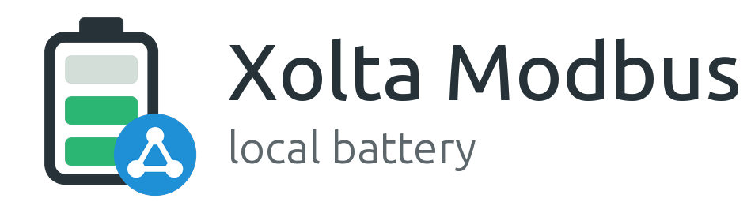

# Ebbefos / Xolta batteri (lokal Modbus) til Home Assistant

[English](README.md) · [Hvad er verificeret](docs/VERIFIED.md)

Læser dit Xolta-batteri (solgt i Danmark af **Ebbefos Energy**) **direkte på dit lokale netværk** via Modbus TCP, uden sky, uden token og uden YAML. Data kommer hvert 10. sekund i stedet for med skyens forsinkelse på 1–2 minutter.

Du kan også slå **styring** til: en overstyring med *Auto / Stop / Eget forbrug*, som fx kan stoppe batteriet, mens elbilen lader.

> Uofficiel integration. Den er ikke lavet af eller tilknyttet Xolta eller Ebbefos Energy. Skrivning til batteriet sker på eget ansvar.

## Før du starter (3 trin)

### 1. Giv batteriets controller en fast IP-adresse
Batteriet har en lille computer (site-controlleren, en Raspberry Pi). I din router hedder den typisk `SCR-…`. Lav en **DHCP-reservation** (fast IP), så adressen ikke skifter. Ellers mister Home Assistant forbindelsen, når routeren giver controlleren en ny adresse.

### 2. Bed Ebbefos om at slå Modbus til
Modbus TCP er slukket fra fabrikken og kan kun slås til af supporten. Send en mail til **support@ebbefosenergy.dk** (eller opret en sag på [support.ebbefosenergy.dk](https://support.ebbefosenergy.dk)). Du kan bruge denne tekst:

> **Emne:** Aktivering af Modbus TCP – SCR-xxxxxxxxx
>
> Hej Ebbefos Energy
>
> Jeg har et Xolta-batteri (konto: *din@email.dk*, site-controller: *SCR-xxxxxxxxx*, IP-adresse: *192.168.x.x*).
>
> Vil I slå Modbus TCP-serveren til på site-controlleren (port 502), og sende mig Modbus-vejledningen ("XOLTA Modbus Interface")?
>
> Jeg vil læse batteriets data lokalt i Home Assistant. IP-adressen er reserveret i min router.
>
> På forhånd tak
> *Dit navn*

Tips:
- **SCR-nummeret** står typisk som enhedens navn i routeren. Kan du ikke finde det, så skriv controllerens MAC-adresse (fra routeren) og den e-mail, du bruger i Ebbefos-appen.
- Erfaring: Modbus blev slået til på under et døgn. Supporten skriver, at de **ikke yder yderligere hjælp** til Modbus. Spørgsmål om integrationen hører derfor til her i [issues](https://github.com/Haulund83/home-assistant_xolta-modbus/issues), ikke hos Ebbefos.
- Del ikke Xoltas PDF offentligt. Integrationen kender allerede registrene.

### 3. Installér integrationen
**Via Marketplace / HACS (anbefalet):** Søg efter *Ebbefos* eller *Xolta* (Ebbefos / Xolta Battery (local Modbus)) og installér. Indtil den er optaget i standardlisten, tilføjes den som brugerdefineret repository: HACS → ⋮ → *Brugerdefinerede repositories* → `https://github.com/Haulund83/home-assistant_xolta-modbus`, type *Integration*. Genstart derefter Home Assistant.

**Manuelt:** Kopiér `custom_components/xolta_modbus` til din `config/custom_components/` og genstart.

## Opsætning
*Indstillinger → Enheder og tjenester → Tilføj integration → Ebbefos / Xolta Battery (local Modbus)*

Du skal kun udfylde to ting:

| Felt | Forklaring |
|---|---|
| **IP-adresse** | Controllerens faste IP-adresse fra trin 1. |
| **Tillad at Home Assistant styrer batteriet** | Slukket (standard): kun læsning, helt ufarligt. Tændt: tilføjer overstyringen (se nedenfor). |

Integrationen tester forbindelsen med det samme og fortæller, hvilken situation du er i:

| Resultat | Betydning |
|---|---|
| Sat op | Modbus er åbent, og entiteterne kommer med det samme. |
| **Modbus er ikke åbnet endnu** | Controlleren svarer på adressen, men ikke på Modbus. Dialogen viser mailen til Ebbefos med din IP-adresse udfyldt. Vælg *Gem og vent*: Home Assistant tester selv videre og starter, når Modbus åbnes. Indtil da står der en besked under *Indstillinger → Reparationer*. |
| Intet svarer | Forkert IP-adresse, batteriet er slukket, eller Home Assistant kan ikke nå netværket. |

Bliver Modbus lukket igen senere (fx af en softwareopdatering fra Xolta), kommer der en besked under Reparationer efter 10 minutter. Den forsvinder af sig selv, når Modbus svarer igen.

Alt andet har fornuftige standardværdier og kan ændres under **Konfigurer**: skrive-kontakten, læseinterval (10 s), gentagelsesinterval (20 s), port (502) og unit-id (1). IP-adressen kan ændres via **⋮ → Omkonfigurer**.

## Det får du

Kun værdier, der er set virke på et rigtigt batteri, er med ([detaljer](docs/VERIFIED.md)).

**Altid (kun læsning):**
- **Ladetilstand** (%), **Effekt** (kW; *positiv = aflader, negativ = lader*)
- **Ladestatus**: Lader / Aflader / Standby (Standby under 0,05 kW)
- **Energi opladet / afladet** (kWh), klar til Energi-dashboardet uden hjælpere
- Tilstand (hviler / starter / kører / fejl)
- Diagnostik: DC-spænding/-strøm, celletemperatur og -spænding (min/maks), lade-/afladegrænse, netfrekvens, AC-spænding/-strøm

**Med styring slået til:**
- **Overstyring** (valg): *Auto (skyen styrer)* · *Stop – brug ikke batteriet* · *Eget forbrug (sælg ikke)*
- **Overstyringens varighed** (timer, standard 4): overstyringen slutter selv og går tilbage til Auto
- **Overstyring slutter** (tidspunkt)
- **Overstyring følges ikke** (problem): tændes, hvis batteriet bevæger sig imod overstyringen. Ved Stop sker det, hvis effekten er over 0,5 kW i 1 minut. Ved Eget forbrug sker det, hvis batteriet lader med over 0,5 kW i 2 minutter.
- Tjenesten `xolta_modbus.set_override` (driftsform + valgfri varighed) til automationer

### Sådan virker overstyringen
Batteriet styres normalt af Ebbefos' sky (plan, arbitrage, skema). Integrationen overstyrer kortvarigt og slipper igen:

- **Stop** skriver driftsform 0. Batteriet stopper inden for ca. 10 sekunder.
- **Eget forbrug** skriver driftsform 1 (maks. eget forbrug). Batteriet dækker husets forbrug uden at sælge til nettet. Skyen nulstiller driftsformen efter ca. 90 sekunder, så integrationen **gentager den hvert 20. sekund**, så længe overstyringen er aktiv. Fra dvale tager det ca. 75 sekunder, før batteriet kører.
- **Auto** skriver **ingenting**. Integrationen holder bare op med at gentage, og skyen tager selv styringen tilbage inden for få minutter.
- Genstarter Home Assistant, eller slukker du for styringen, står overstyringen altid på **Auto**. Batteriet bliver aldrig "glemt" i Stop.

> Batteriets eget driftsform-register viser 0, også når skyen styrer, og vises derfor ikke. Brug **Effekt** til at se, hvad batteriet faktisk gør.

## Batterikort

Integrationen har sit eget dashboard-kort med og indlæser det automatisk; der skal ikke installeres noget ekstra. Redigér et dashboard → **Tilføj kort** → **Ebbefos / Xolta battery**. Kortet finder selv batteriet og viser:

- ladetilstand, ladestatus (lader / aflader / standby) med effekt og batteriets tilstand
- valgfrit net, sol og husets forbrug, hvis du vælger sensorer til det i kort-editoren
- overstyringens knapper (Auto / Stop / Eget forbrug) med sluttidspunkt og en advarsel, hvis batteriet ikke følger den. **Vises kun, når styring er slået til** i integrationen (*Konfigurer → Tillad at Home Assistant styrer batteriet*); kortets *Show override* kan skjule dem igen.

```yaml
type: custom:xolta-battery-card
# alt er valgfrit:
grid_power: sensor.min_net_effekt
solar_power: sensor.min_sol_effekt
home_power: sensor.mit_husforbrug
show_control: true
```

Vil du se hele husets energiflow, passer *Power Flow Card Plus* fra Marketplace fint ved siden af.

## Eksempler

Entitets-id'erne følger det sprog, Home Assistant havde, da integrationen blev tilføjet. Eksemplerne bruger engelske id'er; i en dansk installation hedder fx ladetilstanden `sensor.xolta_modbus_ladetilstand` og overstyringen `select.xolta_modbus_overstyring`. Se id'erne på enhedens side.

**Stop batteriet, mens elbilen lader:** Importér blueprintet
[`blueprints/automation/xolta_modbus/stop_while_ev_charging.yaml`](blueprints/automation/xolta_modbus/stop_while_ev_charging.yaml) (Indstillinger → Automationer → Blueprints → Importér, indsæt GitHub-linket til filen).
Giv den batteriets *Ladestatus*, hvis batteriet kun skal stoppes, mens det aflader; så kan det stadig lade (fx på billig nattestrøm), mens bilen lader.

**Tjeneste i en automation:**
```yaml
action: xolta_modbus.set_override
target:
  entity_id: select.xolta_modbus_override
data:
  mode: self_consumption   # auto | stop | self_consumption
  duration: 2              # timer (valgfri)
```

**Dashboard-kort:**
```yaml
type: entities
title: Batteri
entities:
  - sensor.xolta_modbus_state_of_charge
  - sensor.xolta_modbus_power
  - sensor.xolta_modbus_state
  - select.xolta_modbus_override
  - sensor.xolta_modbus_override_ends
  - binary_sensor.xolta_modbus_override_not_followed
```

**Energi-dashboard:** Brug *Energi opladet* som "energi ind i batteriet" og *Energi afladet* som "energi ud af batteriet".

## Fejlsøgning
| Problem | Løsning |
|---|---|
| "Modbus er ikke åbnet endnu" | Send mailen i trin 2, og vælg *Gem og vent*. |
| "Intet svarer på denne adresse" | Forkert IP-adresse, controlleren har fået en ny IP (lav DHCP-reservation), eller Home Assistant kan ikke nå netværket (VLAN/firewall). |
| Beskeden "Modbus er ikke åbent" under Reparationer, efter det har virket | Sandsynligvis lukket af en softwareopdatering fra Xolta. Bed supporten slå Modbus til igen; integrationen starter selv igen. |
| "Overstyring følges ikke" tænder | Skyen har taget over. Vælg overstyringen igen, eller tjek indstillingerne på Ebbefos-hjemmesiden. |

Diagnostik kan hentes under enheden (⋮ → Download diagnostik). IP-adressen er fjernet fra filen.

## Sikkerhed
- Modbus TCP har ingen adgangskode. Alle på dit lokale netværk kan læse og skrive. Hold batteriet på et betroet netværk (eller et IoT-VLAN, som Home Assistant må nå).
- Site-controlleren har også port 5900 (VNC) åben på LAN. Det er uden for integrationens kontrol, men værd at kende til.

## Teknik
- Ingen afhængigheder. Integrationen har sin egen lille Modbus TCP-klient og kommer derfor aldrig i konflikt med Home Assistants pymodbus.
- To Modbus-kald pr. opdatering: input-registrene 0–43 og 1000–1003.
- Fortegn er målt på et rigtigt anlæg: positiv inverter-effekt = afladning. DC-strømmen har modsat fortegn.

## Licens
MIT
