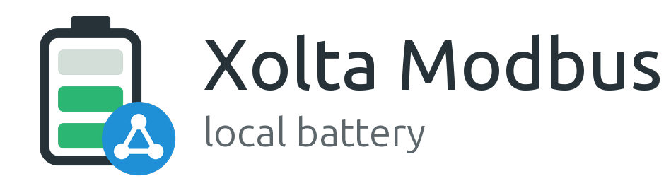

# Xolta Battery (local Modbus) for Home Assistant

[Dansk vejledning](README.da.md) · [What has been verified](docs/VERIFIED.md)

Reads your Xolta home battery (sold in Denmark by **Ebbefos Energy**) **directly over your local network** using Modbus TCP: no cloud, no tokens, no YAML. Values arrive every 10 seconds instead of with the cloud's 1–2 minute delay.

Optionally you can enable **control**: an override with *Auto / Stop / Self-consumption*, e.g. to stop the battery while your EV charges.

> Unofficial. Not made by or affiliated with Xolta or Ebbefos Energy. Writing to the battery is at your own risk.

## Before you start (3 steps)

### 1. Give the battery controller a fixed IP address
The battery has a small computer (the *site controller*, a Raspberry Pi). In your router it is usually named `SCR-…`. Create a **DHCP reservation** so the address never changes. Otherwise Home Assistant loses the connection when the router hands out a new address.

### 2. Ask Ebbefos to enable Modbus
Modbus TCP is off from the factory and can only be enabled by support. E-mail **support@ebbefosenergy.dk** (or open a ticket at [support.ebbefosenergy.dk](https://support.ebbefosenergy.dk)). Danish template:

> **Emne:** Aktivering af Modbus TCP – SCR-xxxxxxxxx
>
> Hej Ebbefos Energy
>
> Jeg har et Xolta-batteri (konto: *din@email.dk*, site-controller: *SCR-xxxxxxxxx*, IP-adresse: *192.168.x.x*).
>
> Vil I slå Modbus TCP-serveren til på site-controlleren (port 502), og sende mig Modbus-vejledningen ("XOLTA Modbus Interface")?
>
> Jeg vil læse batteriets data lokalt i Home Assistant. IP-adressen er reserveret i min router.
>
> På forhånd tak
> *Dit navn*

English version:

> **Subject:** Enable Modbus TCP – SCR-xxxxxxxxx
>
> Hello Ebbefos Energy,
>
> I have a Xolta battery (account: *you@example.com*, site controller: *SCR-xxxxxxxxx*, IP address: *192.168.x.x*).
>
> Could you enable the Modbus TCP server on the site controller (port 502) and send me the Modbus guide ("XOLTA Modbus Interface")?
>
> I want to read the battery locally in Home Assistant. The IP address is reserved in my router.
>
> Thank you,
> *Your name*

Tips:
- The **SCR number** is usually the device name in your router. If you can't find it, give the controller's MAC address (from the router) and the e-mail you use in the Ebbefos app.
- Experience: Modbus was enabled in less than a day. Support says they **do not provide further help** with Modbus, so questions about this integration belong in the [issues](https://github.com/Haulund83/home-assistant_xolta-modbus/issues), not with Ebbefos.
- Please don't publish Xolta's PDF. The integration already knows the registers.

### 3. Install
**HACS (recommended):** search for *Xolta Battery (local Modbus)* and install. Until it is in the HACS default list: HACS → ⋮ → *Custom repositories* → `https://github.com/Haulund83/home-assistant_xolta-modbus`, type *Integration*. Restart Home Assistant.

**Manual:** copy `custom_components/xolta_modbus` to `config/custom_components/` and restart.

## Setup
*Settings → Devices & services → Add integration → Xolta Battery (local Modbus)*

You only fill in two things:

| Field | Meaning |
|---|---|
| **IP address** | The controller's fixed IP address from step 1. |
| **Allow Home Assistant to control the battery** | Off (default): read only, completely safe. On: adds the override (see below). |

The connection is tested right away, and the integration tells you which case you are in:

| Result | Meaning |
|---|---|
| Set up | Modbus is open; entities appear at once. |
| **Modbus is not open yet** | The controller answers on the address, but not on Modbus. The dialog shows the e-mail for Ebbefos with your IP filled in. Choose *Save and wait*: Home Assistant keeps checking and starts by itself when Modbus opens. A notice under *Settings → Repairs* stays until then. |
| Nothing answers | Wrong IP, battery off, or Home Assistant cannot reach that network. |

If Modbus is closed again later (for example by a Xolta software update), a repair notice appears after 10 minutes and disappears by itself when Modbus answers again.

Everything else has sensible defaults and can be changed under **Configure**: the write switch, read interval (10 s), repeat interval (20 s), port (502) and unit id (1). Change the IP address with **⋮ → Reconfigure**.

## What you get

Only values that have been seen working on a real battery are included ([details](docs/VERIFIED.md)).

**Always (read only):**
- State of charge (%), **Power** (kW; *positive = discharging, negative = charging*)
- **Energy charged / discharged** (kWh), ready for the Energy dashboard without helpers
- State (resting / starting / running / fault)
- Diagnostics: DC voltage/current, cell temperature and voltage (min/max), charge/discharge limit, grid frequency, AC voltage/current

**With control enabled:**
- **Override** (select): *Auto (cloud controls)* · *Stop – don't use the battery* · *Self-consumption (don't sell)*
- **Override duration** (hours, default 4): the override ends by itself and returns to Auto
- **Override ends** (timestamp)
- **Override not followed** (problem): on if the battery moves against the override. For Stop: more than 0.5 kW for 1 minute. For Self-consumption: charging more than 0.5 kW for 2 minutes.
- Action `xolta_modbus.set_override` (mode + optional duration) for automations

### How the override works
The battery is normally driven by the Ebbefos cloud (schedule, arbitrage, plans). The integration overrides briefly and then lets go:

- **Stop** writes mode 0. The battery stops within about 10 seconds.
- **Self-consumption** writes mode 1 (max self-consumption). The battery covers the house without exporting. The cloud resets the mode after about 90 seconds, so the integration **repeats it every 20 seconds** while the override is active. From sleep it takes about 75 seconds before the battery runs.
- **Auto** writes **nothing**. The integration simply stops repeating, and the cloud takes control back within a few minutes.
- After a Home Assistant restart, or when control is switched off, the override is always **Auto**. The battery is never left in Stop by accident.

> The battery's own mode register reads 0 even while the cloud is in control, so it is not shown. Use **Power** to see what the battery is really doing.

## Examples

Entity IDs follow the language Home Assistant had when the integration was added. The examples use English IDs; in e.g. a Danish installation the state of charge is `sensor.xolta_modbus_opladning`. Check the IDs on the device page.

**Stop the battery while the EV charges:** import the blueprint
[`blueprints/automation/xolta_modbus/stop_while_ev_charging.yaml`](blueprints/automation/xolta_modbus/stop_while_ev_charging.yaml).

**Action in an automation:**
```yaml
action: xolta_modbus.set_override
target:
  entity_id: select.xolta_modbus_override
data:
  mode: self_consumption   # auto | stop | self_consumption
  duration: 2              # hours (optional)
```

**Dashboard card:**
```yaml
type: entities
title: Battery
entities:
  - sensor.xolta_modbus_state_of_charge
  - sensor.xolta_modbus_power
  - sensor.xolta_modbus_state
  - select.xolta_modbus_override
  - sensor.xolta_modbus_override_ends
  - binary_sensor.xolta_modbus_override_not_followed
```

**Energy dashboard:** use *Energy charged* as "energy going in to the battery" and *Energy discharged* as "energy coming out of the battery".

## Troubleshooting
| Problem | Fix |
|---|---|
| "Modbus is not open yet" | Send the e-mail from step 2, then choose *Save and wait*. |
| "Nothing answers at this address" | Wrong IP, the controller got a new IP (make a DHCP reservation), or Home Assistant cannot reach that network (VLAN/firewall). |
| Repair notice "Modbus is not open" after it used to work | Probably closed by a Xolta software update. Ask support to enable Modbus again; the integration resumes by itself. |
| "Override not followed" turns on | The cloud took over. Select the override again, or check the settings on the Ebbefos website. |

Download diagnostics from the device page (⋮ → Download diagnostics). The IP address is redacted.

## Security
- Modbus TCP has no password. Anyone on your LAN can read and write. Keep the battery on a trusted network (or an IoT VLAN that Home Assistant can reach).
- The site controller also has port 5900 (VNC) open on the LAN. This is outside the integration's control but worth knowing.

## Technical notes
- No dependencies: the integration has its own small Modbus TCP client, so it never conflicts with Home Assistant's pymodbus.
- Two Modbus requests per update: input registers 0–43 and 1000–1003.
- Signs measured on a real system: positive inverter power = discharging; DC current has the opposite sign.

## License
MIT
